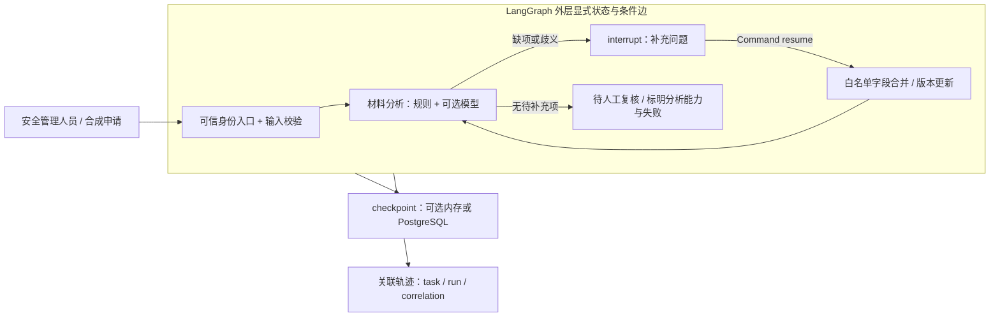
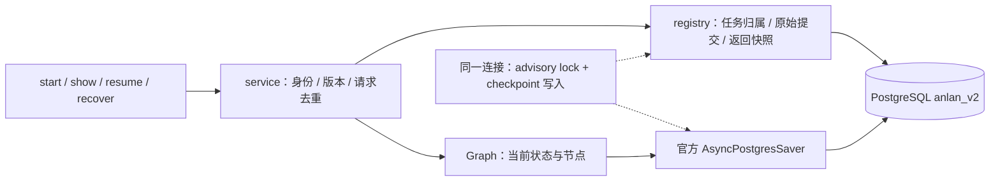
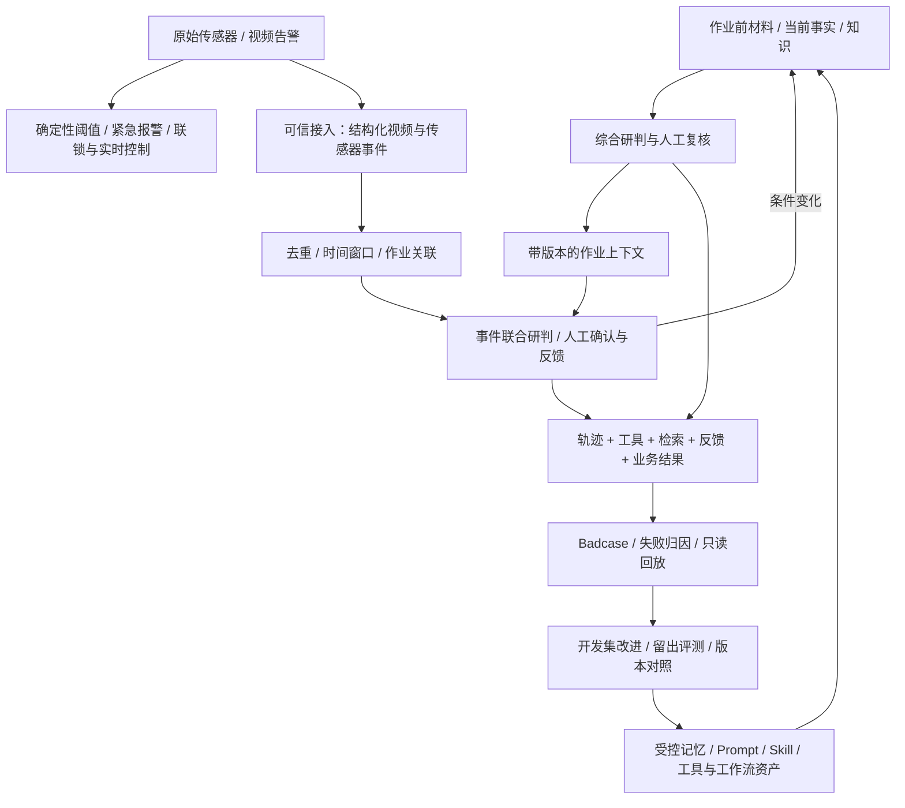
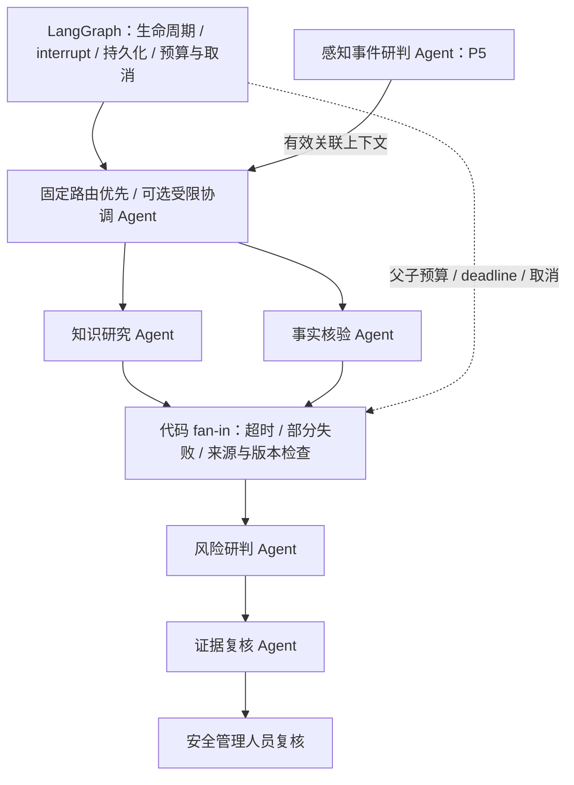

# 架构：当前基线与已确定的演进边界

当前实际架构：Python CLI、Pydantic、LangGraph材料状态图与官方PG checkpoint；工具/知识、共享请求预占、用户偏好与上下文、受控并行及两职责模型复核已实现。Java仅为两个既有只读事实工具提供HTTP门面，官方MCP stdio适配接入同一Python规则。pgvector0.8.6、本地BGE/512维、知识版本/过滤与Jaeger保留；FastAPI/Compose仍后置。R1按职责分包，状态以[status](status.md)为准。

## 职责包与依赖入口（R1）

`interfaces`承接CLI/HTTP/MCP与具体装配；`workflows`承接材料和证据流程；`llm`封装模型配置/网关/适配；`knowledge`、`memory`、`context`、`tools`保留功能合同及实现；`infrastructure`管理连接、持久化、预算、观测；`common`只有确实共享的基础DTO和错误。__init__不装配实现。完整[目录/映射/验证](refactoring/package-layout-report.md)与[ADR009](decisions/009-responsibility-packages.md)。

数据库配置`infrastructure/db.py`不导入工作流。Memory/Knowledge/Budget只依赖该连接层；context只依赖memory/contracts的偏好枚举。KnowledgeCitation在knowledge/contracts，AnalysisFailure在llm/contracts。业务自己的合同靠近功能，不借旧根模块重导出实现。旧命令有5个薄转发，内部导入与monkeypatch统一走规范模块；SQL/assets及历史冻结工件保持原位/原字节。

P2工程Gate于2026-09-21通过，平台追踪已接入Jaeger2.21/OTLP（替代本机缺少Docker条件的Langfuse部署），FastAPI/Compose仍后置。`trace.py`先保存JSONL，再可选导出白名单元数据；run为trace、工具/模型为子span。普通导出异常显式告警并保留业务结果；归档导入独立命名、保留时间缺口，不执行模型或恢复业务。见[ADR005](decisions/005-local-observability.md)与[P2交接](phases/phase-02-tools-rag/handoff.md)。

节点像 Java 的应用服务方法；TypedDict 描述图状态的形状，不负责运行时校验；Pydantic 类类似带 Bean Validation 的 DTO。节点返回部分状态更新，由 LangGraph 合并。材料始终只由经校验的用户输入更新；模型仅返回候选问题。`interrupt` 所在节点恢复时会从头执行，所以模型请求不放在该节点中。

模型失败不直接决定进入复核：代码保留规则缺项，有缺项仍进入 `waiting_input`，无缺项才进入 `awaiting_review`，同时保留 `semantic_status=failed`。依据 `workflow.py` 的规则合并与条件路由，以及冻结案例 `p1-08-model-timeout`；P2冷启动时修正了图中“或模型失败”的不准确简写。

首轮字段为位置、对象、方式、附件说明（沿用旧素材的字段名便于理解，判定规则是新版合成假设）。空字段由代码提问；模型识别明确歧义、缺细节、矛盾，必须返回字段内原文引用。引用存在只证明定位正确，不证明缺陷判断正确。模型无工具、无身份写入权、无批准字段。

身份与状态：tenant/user 是 CLI 本地测试入口注入的模拟可信身份，不来自材料或模型，尚不是生产鉴权。session 表示本次交互容器，task 是业务材料任务，thread 是 checkpoint 游标，run 表示一次提交执行；故障恢复沿用未完成提交的 run_id，correlation 串联任务。request_id 标识一次用户提交，重试保留；不能把框架 thread 当租户隔离机制。应用入口先检查归属再读写状态，PG 模式使用任务级锁与同连接写入阻止并发消费和丢锁后旧写。

### WP02 的持久化调用链

`interfaces/runtime.py` 在同一专用连接上组合 registry 与 saver，连接丢失即同时丢锁且无法写 checkpoint。初始创建先写归属，CLI 输出 task_id 回执后执行图。每次补充先持久化 operation，然后以 `durability="sync"` 写节点 checkpoint，最后保存完成回执；各次提交并非一个跨系统事务。故障留下 pending，recover 判断该 run 是否已合并输入，再继续未完成节点；已完成请求直接返回旧回执，用 show 取最新状态。分析完成但尚未进入 ask 的节点边界也需继续至 interrupt，不能仅凭 status 字符串认定可补充。

相关实现：`workflows/registry.py`的合同/内存实现、`infrastructure/postgres.py`的SQL/serializer/setup、`sql/001_registry.sql`的任务/提交表、`workflows/service.py`的幂等/恢复决策。图状态不接受模型写身份/批准。checkpoint的受限反序列化不开放pickle回退。详细取舍见[ADR002](decisions/002-postgres-recovery.md)。

部署实测使用独立 PG17.11（端口55432）。本机中文路径触发 PG 初始化编码失败，数据库运行文件放在用户 LocalAppData 的英文目录，源码不移动；脚本、位置和停止方法见 README。系统原 PG10 服务保持原样。记忆、生产认证、数据库备份和最终状态修改不在 WP02 范围。

## P2-WP01 当前事实核验

`check-facts`在模型初始化前分流：宿主Identity → `service.get`校验任务归属并取材料快照 → `FactReferences`校验独立对象引用 → 固定顺序两个工具 → 独立证据包/JSONL。`tools/queries.py`先按合成access清单检查tenant/user/object，再读取资质或区域记录；路径由宿主配置，业务ID不拼接文件路径。

参数、记录、结果由`tools/contracts.py`校验。单文件256KiB上限，带时区有效区间[start,end)，查询时点不能早于观察时点；同租户对象/资质类型键必须唯一。来源版本和原始字节摘要随证据返回；只有ok携带当前事实，unknown与error保留不同原因。工具默认2秒，无重试；异步超时加发布前单调时钟检查防止迟到成功。线程中的底层文件读取不能强制取消，但不发布迟到结果。

`facts.py`新建核验run，沿用task/correlation并记录源revision/source_run/material_status；不写入Graph、registry或operation。输出的awaiting_review只描述证据包，原材料状态不变。快照之后允许材料继续更新，消费者须比较源revision，不能把旧证据视为当前材料的最终结论。两个工具之一失败时仍保留另一个结果。JSONL记录工具名、原因、来源和时点，不保存事实正文；轨迹写入失败显示缺口。

该入口是代码固定路由；身份仍是本地模拟，合成文件不代表企业数据。WP02另提供以下模型循环，复用同一工具执行边界。

### P2-WP02 有界模型循环与预算

`check-facts-agent` → 已授权材料快照/引用 → 模型动作 → 白名单/严格参数/引用范围校验 → 只读工具 → 按call_id反馈观察 → 模型停止或代码预算截止。每次核验最多3回合/4动作/75秒；非法动作被拒绝并形成观察，最终摘要必须引用两个工具的观察但仍是未验证候选。

`model_gateway.py`在HTTP前调用`budget.py.reserve`并等待提交。SQL002新增项目级授权/尝试表，以授权行锁串行化计数与插入；成功、失败、未知预占都计数，无重置退款。`live.py`集中固定生产授权，P1材料模型入口也接入。超时、输出无效、用量未知与附加快照失败都有显式记录；隐藏推理不进入报告。决定与边界见[ADR003](decisions/003-model-budget-and-tool-loop.md)，原始小样本证据见[WP02交接](phases/phase-02-tools-rag/wp02-handoff.md)。

### P2-WP03 知识依据

`knowledge-ingest`校验SYNTHETIC文档→确定性片段/摘要→本地BGE真实512维编码→知识版本与片段同事务提交。tenant/owner来自入口，读者清单属示例文档元数据。新版本使旧版本非current，同版本变内容拒绝；撤回后不得升版静默恢复，修改/撤回仅限owner。

`knowledge-query`本地编码问题→PG先筛tenant/user/current/withdrawn/有效期/编码器→精确余弦候选→可选词项混合重排→首条摘录与其他候选。无合格候选返回unknown，输出原文/版本/内容摘要/有效期；文内指令不变成权限。当前每篇一个片段的8题开发对照显示混合无收益，选择简单默认；摘录式回答与未来模型生成质量分开。细节见[ADR004](decisions/004-synthetic-knowledge-retrieval.md)。

### P2-WP04 同一链路的知识引用

可选knowledge_question启用第三个固定工具query_knowledge；模型只能逐字传入口问题，不能传身份/SQL或注册新工具。复用原循环预算与task/run/correlation，必须观察三个工具。最终chunk/quote与本轮返回原文逐字校验，摘要保持未验证候选，不写Graph。知识初始化/原生推理异常转明确错误观察，其他事实仍保留；用户取消继续传播。

真实三例验证证明小样本动作与引用链路可用，不证明自由摘要的每条主张都被充分引用；第二例的引用覆盖Badcase保留于[WP04实验](phases/phase-02-tools-rag/evidence/wp04/live-report.md)。模型引用模式的真实调用归P2-WP04，使用同一项目累计授权，不重置总额。

## 全周期数据流（P1—P5工程主链已实现，质量复盘继续演进）

SAFE 不依赖 Agent 成功、响应或存在；Agent 无 SAFE 的写权限。P5当前最小合同包括schema_version、data_origin、event_id、sequence、kind、object_ref、observed_at/expires_at和active原始报警；视频另有confidence，传感器另有value与percent_lel单位。可信宿主SourceBinding给出identity/source/task/revision/run与有效窗口，正文不能补造身份。原始记录先提交，乱序/重复/过期/错误关联保留原因，感知失败不修改原报警。真实设备evidence_ref、site和阈值版本管理尚未接入；当前仅模拟上游异常声明。感知真实模型0/2仍未通过质量验收。

## 多 Agent 协作方向（P4 才实现）

| 职责 | 最小上下文 | 工具权限 | 输出 / 不拥有的权力 |
|---|---|---|---|
| 协调 | 任务摘要、专业角色目录、剩余预算、执行状态 | 委派白名单 | 有界计划与执行状态；不能任意调用工具或写业务状态 |
| 知识研究 | 风险主题、租户过滤、有效时点 | 示例知识/案例检索、引用解析 | 带版本有效期证据；案例不等于当前事实 |
| 事实核验 | 对象引用、所需事实类别和时效 | 资质/设备/区域/天气/相邻作业只读查询 | 来源时间明确的事实或错误；不猜工具结果 |
| 风险研判 | 申请版本、事实、知识、只读规则结果 | 初版无工具，消费证据包 | 候选风险、未知、冲突和建议；不覆盖规则、不批准 |
| 证据复核 | 主张与引用映射、来源元数据 | 引用与有效性只读检查 | 支持性、冲突与缺证报告；不补造证据 |
| 感知事件研判 | 结构化事件、作业/区域/时间窗口 | 关联对象只读查询 | 保留 evidence_ref/confidence 的可用上下文；不关闭或降级告警 |

所有子任务传递 task_id/run_id/correlation_id、输入版本、deadline 和预算，独立上下文与白名单；身份另由执行上下文提供。Graph 节点校验子结果后才更新共享状态，不能让 Agent 直接写共享状态。两只读分支先并行；超时/部分失败返回显式未知，取消传递到子任务，重试不得突破父预算。冲突由来源与时效检查汇总给人，不以多数 Agent 同意替代证据。

演进顺序：单工作流 → 单 Agent 受控工具循环与综合研判基线 → 知识/事实两个专业 Agent 并行 → 风险/证据复核与受限协调 → 感知协作扩展。用同任务集比较成功率、调用正确率、引用支持、冲突发现、token/费用与延迟，再做去掉证据复核的消融；无收益的拆分允许退出主链。

## 用户Memory（P3-WP01）

`memory/store.py`在既有PG维护来源/当前状态/版本审计，`interfaces/memory_cli.py`提供独立本地模拟入口。SYNTHETIC反馈经枚举白名单生成candidate，明确确认才active；冲突、过期、删除立即不进入普通读取，修正重新确认。tenant/user来自入口，source_ref/version有实际登记归属，hash由代码计算。当前事实仍查询工具、材料仍来自checkpoint、示例依据仍来自知识库，记忆只影响后续呈现。事务、版本与重放边界见[ADR006](decisions/006-user-memory-lifecycle.md)。

## 官方接口依据

P3新增的上下文和综合边界见[ADR007](decisions/007-bounded-review-context.md)：最大24000序列化UTF-8字节，材料/事实/未知必保，知识原文和有效枚举偏好可裁剪；固定三工具采集后一次模型综合。逐条引用与未知清单由宿主校验，模型结果仅候选，指引不是权限来源。单/多Agent后续对照使用这条固定采集基线，不能与P2模型自主选工具循环混同。

2026-09-17 核实：[LangGraph interrupts](https://docs.langchain.com/oss/python/langgraph/interrupts)（节点重入、checkpoint、Command resume），[官方包元数据](https://pypi.org/project/langgraph/)（Python ≥3.10），[DeepSeek JSON Output](https://api-docs.deepseek.com/guides/json_mode/) 与 [Chat Completions](https://api-docs.deepseek.com/api/create-chat-completion/)（JSON 模式与非思考请求）。实际解析出的版本保存在根目录 uv.lock；联网和效果验证另记，文档兼容不替代运行验证。

## 历史资料来源与适用范围

旧仓库 `D:/src/agent学习/gpt下的安澜` 只读；本轮未复制原文数据或源码，未迁移任务清单/旧状态/旧架构。以下路径均相对旧仓库，链接指回原文件；这些链接失效不影响新仓库运行。

| 已读来源 | 2.0 提取的内容 | 明确不继承 |
|---|---|---|
| [用例](D:/src/agent学习/gpt下的安澜/docs/02-requirements/04-hot-work-use-cases.md) | 材料补充、事实查询、知识、辅助分析、人工复核、模型/工具故障场景 | 完整审批状态机、Java 唯一权威、旧 Phase 与签核 |
| [任务规格](D:/src/agent学习/gpt下的安澜/docs/02-requirements/06-agent-task-specification.md) | 输入/输出、来源/未知/冲突与评估问题 | 任务号作为节点、固定旧预算、Memory 默认禁用 |
| [B3 数据说明](D:/src/agent学习/gpt下的安澜/datasets/b3/application-completeness/v1/README.md)、同目录 manifest / inputs / gold / boundary-cases | 四字段问题形式、局部误报和类型/权限/输出边界思路；24 语义样本+12 边界样本 | 全部已见，只能做开发/回归参考；本包未迁移数据文件；以后迁移保留原件与来源，适配另版 |
| [旧报告](D:/src/agent学习/gpt下的安澜/evidence/b3-cloud-live/reports/20260916T141104448855Z-continuation/final-report.md) 与 [findings](D:/src/agent学习/gpt下的安澜/evidence/b3-cloud-live/reports/20260916T141104448855Z-continuation/agent-findings.md) | 结构有效与语义正确分离；额外字段误报、类别混淆、传输失败分开归因 | 53.3% precision 仅属旧四字段合成口径，不能沿用为新版基线；旧费用/批准非本项目无限授权 |

旧报告有 23/24 收到候选、23/23 结构有效、45 条建议中 24 命中/21 误报；20 个误报是额外字段缺陷，另 1 个是类别混淆。有效原文引用不保证主张得到支持。这些观察只指导本包保守 Prompt 与输出复验设计，尚未证明新版 Prompt 更好。旧 B4 设计/Prompt/数据本轮未读取，尤其未打开 holdout-gold；等真实优化问题出现再有选择参考。

## P5服务与持久快照

宿主Bearer配置 → 可信Identity → 原WorkflowService/EventStore/PerceptionRuntime → PG。材料锁与Saver共用连接；原始事件先独立提交，重核结果/反馈校验材料revision、来源水位和时效。review运行锁防止恢复时重发，cancel_requested由PG保存并在终态事务中复核。SSE只是受权读取持久快照与摘要ID，断流不取消业务，不保证传递全部历史中间事件。

[ADR011](decisions/011-synthetic-event-association.md)、[ADR012](decisions/012-material-revision-and-perception-review.md)、[ADR013](decisions/013-local-api-and-snapshot-stream.md)与[P5模块入口](phases/phase-05-events-service/module-map.md)记录当前实现；[Q-P5-001](quality-items.md)保留真实模型质量未通过，不以接口/替身通过替代。
