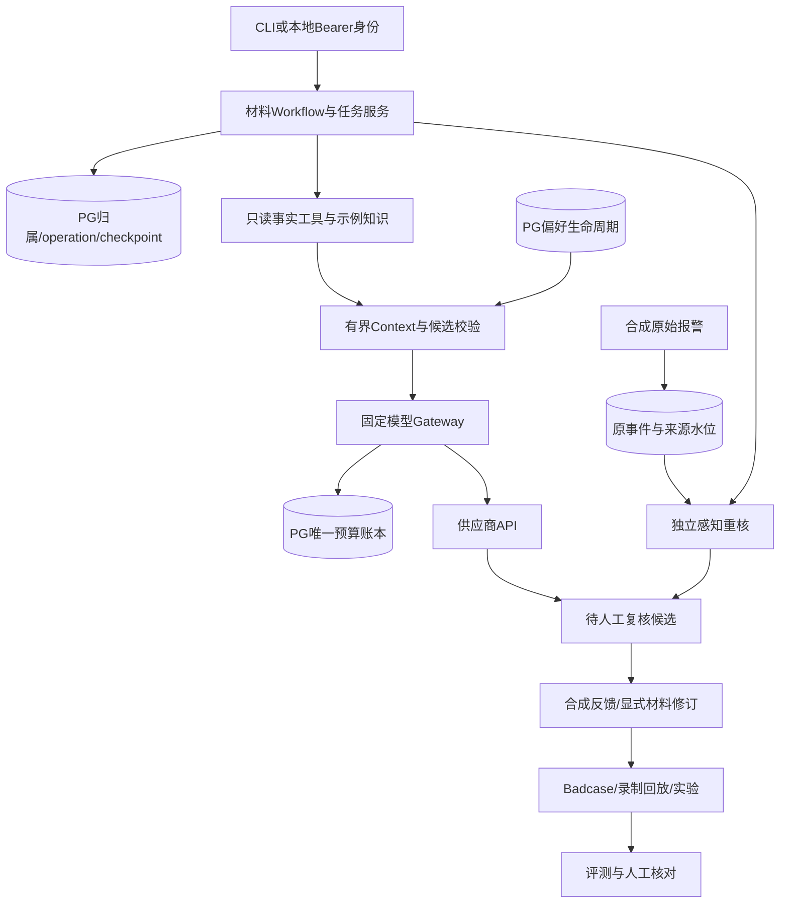

# 架构讲解路线

先解释“谁能决定什么”，再解释框架。模型输出只是候选；宿主决定身份、工具范围、版本与请求预算；人工决定业务结论。所有输入为合成学习数据。

这里没有从候选返回报警控制/作业批准的箭头。反馈写审计，不能改报警。PG是状态/预算权威，Jaeger/JSONL提供观察，不替代恢复账本。

## 五个讲解点

1. **材料状态与提交不是同一事务。** Graph存当前状态，registry持久归属和初始种子，operation保存request_id/run/revision与结果；pending与recover协调两次提交。任务锁和saver共用连接，避免丢锁的旧执行继续写回。根依据[ADR002](../../decisions/002-postgres-recovery.md)。
2. **事实、知识、记忆用途不同。** 事实来自本轮授权查询；知识是有时效和版本的示例原文；记忆只是用户呈现偏好；历史摘要不是当前事实。引用存在不能证明支持主张，偏好不能隐藏未知。看ADR004/006/007和[Memory比较](memory-comparison.md)。
3. **并行采集与多职责模型不同。** P4工具分支是固定宿主并行；风险/证据复核是同模型两次独立上下文；不是自由自治团队或不同模型投票。父子预算、截止、部分失败和取消单独处理；实际对照有增加成本但无收益的结果。
4. **事件与材料版本各有边界。** 原报警先保存，来源配置绑定task/object/revision/run及时窗；材料显式revise才升版。旧候选可能stale，反馈需校验当前性；看ADR011/012。SSE是最新PG快照，不是逐token输出或完整事件队列。
5. **可靠性结论要带范围。** 同任务get使用非阻塞任务锁可返回409；材料恢复可能重复外部请求，感知recover不重发模型；预算已预占即占数；本地CI、清洁wheel、脚本成功不能证明模型质量/生产SLA。

## 面试追问时打开的文件

| 追问 | 文件/证据 |
|---|---|
| 幂等与丢锁 | `src/anlan/infrastructure/postgres.py`、`workflows/registry.py`；ADR002 |
| 模型调用有何上限 | `llm/gateway.py`、`infrastructure/budget.py`；46次真实PGattempt归属 |
| 为什么不把所有内容做Memory | `memory/contracts.py`、`memory/store.py`、P3无/有记忆对照 |
| 一次失败怎样变成回归 | `workflows/quality.py`、P6-WP02重复unknown开发前后报告 |
| 为什么不加更多Agent | P6单/双2任务的成本/墙钟与Judge误判原件 |
| Java有什么作用 | 两只读业务API与Python事实核心/MCP桥接；ADR010，不是第二事实库 |

以上用于准备讲解，是否能由本人不看稿解释需另验。不能把本页背诵等同独立掌握。
