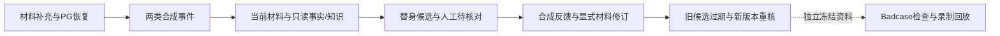

# 可复现主链演示

本演示由AI实现和运行，使用合成材料、示例制度、真实本地PG/BGE和明确模型替身。它不证明本人已能独立操作，也不证明真实视觉识别、企业合规或生产能力。真实模型历史结果另见[已知限制](known-limitations.md)。

## 一条命令运行

在项目根目录的PowerShell执行；前提是README中的锁定环境、项目PG17和本地BGE缓存已经准备好。新机器先按README安装，不在演示中隐式安装或下载。

```powershell
$env:PYTHONUTF8 = '1'
scripts/dev-postgres.ps1 -Action Status
# 仅项目实例未运行时：scripts/dev-postgres.ps1 -Action Start
scripts/dev-postgres.ps1 -Action Env
$demoDir = '.runtime/takeover-' + [guid]::NewGuid().ToString('N')
.venv/Scripts/python.exe scripts/takeover_demo.py --output-dir $demoDir
$demoReport = Get-Content "$demoDir/report.json" -Raw | ConvertFrom-Json
$demoReport | Select-Object status, failed_stage, model_request_delta, personal_evidence
$demoReport.steps | Select-Object name, status, checks
```

预期：`status=passed`、`failed_stage=null`、`model_request_delta=0`、`personal_evidence=not_provided`。五段分别通过。任何已有输出目录都拒绝复用；失败报告也要保存。账本读不到时增量为null而非0。运行会创建合成PG任务及事件/反馈，不会修改旧实验记录或读取模型密钥。`--help`没有live模式。

每个子阶段上限180秒，Windows使用已锁定的pywin32依赖和匿名Job Object管理本次进程树；启动屏障保证绑定后才运行项目代码，清理失败不能报告通过。此界限是演示编排保护，不是生产SLA。父进程须来自当前`src/anlan`，子进程明确绑定此目录。非Windows清理分支未在本机实测。

## 按证据讲解约十分钟



图是讲解顺序。材料循环、两条感知链使用独立task_id；质量集来自历史冻结数据，并非本次反馈自动转成新Badcase。

| 阶段/文件 | 打开后观察 | 能证明什么 |
|---|---|---|
| `materials.json` | 9条跨进程CLI；3次材料revision；重复请求返回原结果；旧revision/异租户拒绝；PG三条operation | 材料追问/补充/幂等与持久化，offline不判断真实语义 |
| `perception.json` | 两行分别helmet_missing/gas_abnormal；review中的观察o1/o2/o3、引用、候选及未知 | 实际本地事实/知识查询；候选为scripted_double |
| 同文件反馈与修订 | needs_verification；revision增加；stale_after_revision=stale_material；follow_up关联新revision | 原始报警不变，显式修订才改变材料，旧候选不能当当前结论 |
| `inspect.json` | 11项来源SHA、family/split、反馈来源、缺输出 | 只读元数据，不发模型或重查事实 |
| `dev.json` / `holdout.json` | 开发6项合同匹配含2项not_replayable；5项已见合同留出匹配 | 重验录制候选；旧无输出仍不可回放，零新增模型成功 |
| `report.json` | 每段命令/结果、源码前后摘要、工件SHA、PG前后账本 | 本次运行可定位/复核；摘要不防本地管理员篡改 |

看候选时，先说明身份和材料revision，再看实际工具观察及引用，最后看候选。不要从“Schema合法”直接跳到“语义正确”或“可以批准”。

## HTTP/SSE演示另算

本命令是CLI/应用链，不声称再次验过HTTP。现有[P6清洁服务证据](../phase-06-quality-reliability/evidence/wp04/clean-service.json)包含两类HTTP、SSE断连/重连和进程重启；该历史wheel与P6最终CI指纹一致。需要自己重放服务时使用新配置与新证据路径：

```powershell
scripts/dev-postgres.ps1 -Action Env
$runKey = [guid]::NewGuid().ToString('N')
$configPath = ".runtime/service-$runKey.json"
.venv/Scripts/python.exe scripts/prepare_service_demo.py --output $configPath
.venv/Scripts/python.exe scripts/smoke_service.py --python .runtime/p5-service-clean/venv/Scripts/python.exe --config $configPath --output ".runtime/http-$runKey.json"
```

这要求已有干净venv中的项目wheel与目标源码一致；改过业务代码必须先按P6构建流程更新wheel并核对SHA。配置含本地随机Bearer token，不打印/提交；服务脚本仅停止它启动的服务。SSE传PG最新快照，断线不等于取消，不保证全部中间事件送达。

## 代码定位

入口编排：`scripts/takeover_demo.py`；材料服务：`src/anlan/workflows/service.py`及`interfaces/runtime.py`；来源与重核：`interfaces/perception_runtime.py`、`infrastructure/events.py`、`infrastructure/perception.py`；质量回放：`workflows/quality.py`、`interfaces/quality_cli.py`。锁/恢复看ADR002，预算ADR003，事件ADR011，修订ADR012，服务ADR013。

失败先查[排错路径](troubleshooting.md)。本人练习与证据要求见[WP01学习](wp01-learning.md)。
