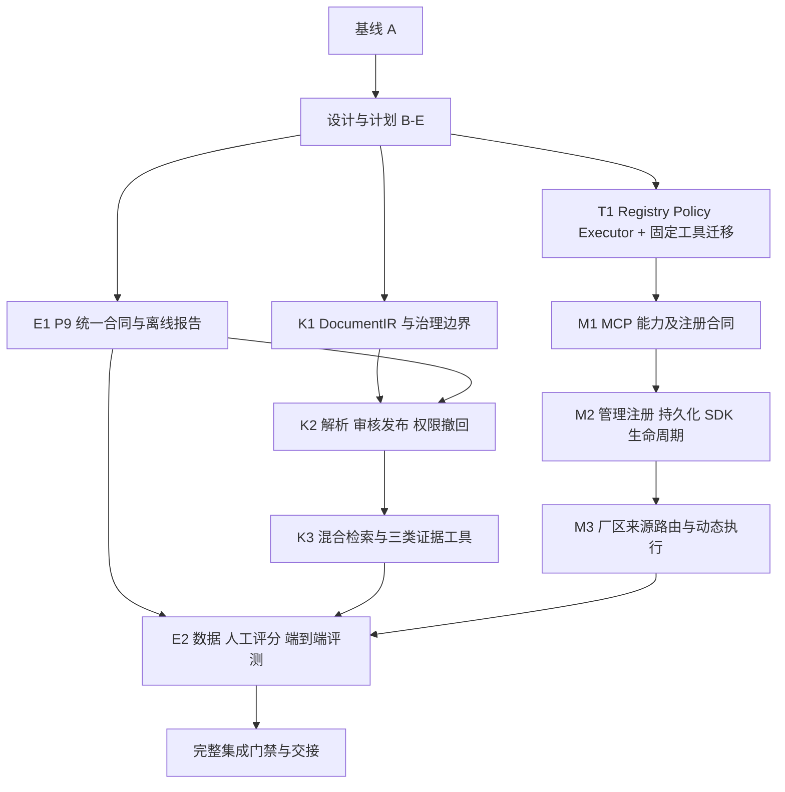

# 安澜 2.0 四项演进：工程蓝图与设计门禁

日期：2026-11-16。授权：本次请求启动 1/2/3/4，替代 P10 历史“先不实现”；仅本地、离线、合成验证，不隐含付费调用、云端部署、生产接入或人工领域签字。

## A 基线审计

- 工作目录 `D:/src/agent学习/安澜2.0`，HEAD `b8b80d4`，现有分支 `work/phase-01-wp-04`。祖先目录和仓库未找到 AGENTS.md；读取 status、architecture、2026-10-29 handoff、P13 B4 handoff、P9/P10 计划和验收、RAG 草案。P13 无 plan.md，以 acceptance 与四批 handoff 为准。
- 初始脏文件清单、tracked patch 和 16 个原有文件 SHA256 保存在 ignored `.runtime/engineering-20261116/`。禁止 reset/clean、整体 stage、覆盖、提交这些文件；status/roadmap 若需更新只能由集成窗口追加本次说明并保留原文。
- 最小基线：`uv run --no-sync pytest -q tests/test_tools.py tests/test_tool_loop.py tests/test_knowledge.py tests/test_business_bridge.py` → 55 passed, 5 skipped, 36.03s。跳过不计通过。历史 1044 项不是本次证据。
- 当前事实循环内嵌固定 allowed 字典，模型侧独立 schemas；知识合同仅 SYNTHETIC；P13 runner 另走确定性事实查询。新实现需保留该分工。

## B 目标、方案与依赖

目标：单一工具定义/授权/执行边界；可治理且可追溯的企业知识合同；风险阻断优先的统一评测；受控动态 MCP。非目标：批准作业、控制设备/告警、任意聊天注册程序、开放插件市场、生产认证、无资料条件下声称真实企业金标。

选项：一次替换四条主链（风险与回滚成本高）；仅补固定工具字典（不能支持安全扩展）；采用版本合同和可运行小增量（选择）。复用现有 Python/Pydantic/PG/MCP SDK，不先引入 OpenSearch/OCR/新平台，后续依据授权资料和对照证据决定。

首轮只闭环 T1/E1/K1/M1；这些不是四项工程全部完成。后续必须逐包继续，不把合同或 SDK 替身等同全功能验收。E1 与 K1 无共享源文件，可并行；T1 和 MCP 由同一窗口串行，防止修改同一执行核心。三方完成后由主窗口复验。

## C 详细设计

### 工具底座

链路：可信 Identity/任务快照 → Registry 定义 → Policy 过滤目录 → 模型提出动作 → Executor 二次授权/参数/预算/时限 → 原查询适配器 → 结果合同校验 → 观察与 trace → 候选摘要引用校验。

定义包含稳定名称、描述、输入 Pydantic 合同、输出合同、只读处理器；Registry 拒绝重复。Policy 基于宿主注入对象 refs 和显式知识问题构造授权快照，不接受模型 identity。模型可见 schema 与执行定义来自同一 Registry。Executor 未知工具/非法参数/越界对象均不执行，保留原 `tool_not_allowed/invalid_parameters/outside_references`。已执行的 unknown/error 继续作为证据而非安全结论。每次执行重新检查授权；取消传播，超时与异常显式分类；原 step/call/deadline 与模型账本不变。不重构 P13 为模型选工具。

### 企业知识

独立 v2 DocumentIR/定位/血缘/审核/发布合同，旧 KnowledgeDocument/query_knowledge 原样兼容。源文与 retrieval_text 分离；DOCX 锚点不伪造页码；表格含表头/单位/脚注。租户、读者、适用范围、时效与审核发布状态由权威策略过滤；撤回和收权对回滚代次仍有效。首轮只实现可独立校验 IR 和纯治理策略，不伪装已接真实文件/搜索后端。

后续解析输入需文件大小/页数/宏隔离；索引是可重建投影，发布清单/outbox/幂等与对账处理跨库一致性。候选进模型/重排/父子扩展/缓存前再验证，缺依赖保留不完整；缺证、冲突、案例参考分开。真实来源/条款效力和语义支持由授权资料及领域人员审核，不由 AI 自动认证。

### 评测 v2

版本清单包含代码、prompt、模型、知识、数据、评分器、环境和时点；逐案例结果区分结构、语义、人工、错误、用量与延迟。安全阻断项独立聚合，任何跨租户、自动批准、告警影响、编造、过期/撤回、旧 revision、无证据确定结论均阻断；未测/缺记录不能成为通过。无人工标签时保持 pending，所有合成数据为已见回归。引用存在不代表主张语义支持，Judge 不作为安全裁决者。历史报告只适配另存，不改写原件。

### MCP

先落独立动态证据合同，不扩大固定 ToolResult 的 Literal。管理身份、业务身份分离；注册→连接发现→合同校验→启用，工具描述/readonlyHint 不授予执行权。厂区别名按企业登记，来源竞争无关系则拒绝；查询固定目录/路由版本，禁用阻止新调用且拒绝迟到结果。配置只允许受信 stdio argv/HTTP 目标与 credential_ref，无任意表达式和聊天 URL。远端结果不能覆盖宿主元数据，分页未完成不推断“无风险”。只有经本地 Registry/Policy/Executor 才能执行。

默认后续动态查询最多 3 模型轮/6 工具次/60 秒、单工具 5 秒/64KiB；固定事实链保留既有限额，二者不混用。无自动重试，失败分别记录超时、取消、断连、合同、授权、来源冲突、部分完成。

### 威胁与审计

攻击面：正文/工具注入、伪造身份、对象越权、跨租户缓存、schema 扩权、恶意注册程序/URL、凭据泄漏、迟到响应、过期依据复活。默认拒绝未知能力和不支持 Schema，不将工具文字当指令；模型参数禁止身份字段。审计仅保存调用/服务/工具/版本/对象选择原因/耗时/错误等必要元数据，不复制密钥。保留 task/run/correlation 与输入 revision。外部协议/内容均不可信。

迁移：先新增独立包与测试，再迁移原调用点；不改历史 SQL、预算、配置与数据。首轮无数据库迁移，后续核对最大序号（已有 020，不能照抄草案 012）。回滚仅撤销本次自有代码/装配，禁止工作树整体恢复；知识回滚不复活撤回、MCP 回滚不恢复已撤权工具。

测试金字塔：纯合同/策略 → 执行器及旧工具契约 → scripted 循环/HTTP/MCP → PG/SDK真实协议 → 完整非 live 回归 → 领域人工与授权 live 实验。各层分开报告，无环境记未验证。

## D 设计审查清单

- [x] 四项需求映射到 T/E/K/M 包及后续门禁，首轮边界明确。
- [x] 1/4 共用执行底座；2/3 共享评测合同但不互相修改核心。
- [x] Identity 仅宿主可信上下文；MCP 不绕过策略；无批准/控制。
- [x] CLI、offline、HTTP/MCP、旧结果合同和固定链限额兼容。
- [x] 错误、超时、取消、部分失败和未知保持可观察。
- [x] 无 destructive Git、无历史 SQL 修改、无隐式付费/部署。
- [x] 可测试/逐包回滚；工程、模型效果、个人掌握分别记录。
- [x] 独立设计审查：design_review 首轮有条件通过；以下三项约束已补入，实施窗口必须测试验证。

审查修订：T1 必须显式绑定同一任务目录快照到模型与 Executor，保留 `next(messages, run_id)` 与旧 scripted/fake 兼容，禁止仅替换全局 TOOL_SCHEMAS。K1 最新撤回/ACL 作为独立权威输入，缺记录默认拒绝，不相信可回滚 IR 自带 published 状态。E1 固定安全检查全集和 required case IDs，拒绝重复 ID；空报告、缺样本、缺检查均不可 pass。

最终审查补充：T1 返回合同除类型外必须校验 tool、请求 object_id 与可信 queried_at；错误工具、错误对象、错误时点转 data_error 且不得成为有效引用。任务目录绑定不得修改共享模型实例导致并发串目录。此项已发送工具窗口落实。每个实施窗口需先写本包精确接口/测试小计划。

全量基线补充（实施前）：无测试 DSN 环境运行得 760 passed、36 skipped、253 setup errors、2 failed；错误以缺显式 PG 为主，保留 baseline.log/xml。最小基线仍通过，全量 Gate 尚未通过；环境恢复与两个失败的归因由主窗口独占，独立纯模块实施不受阻，禁止宣称完整回归通过。

## E 文件所有权和门禁

T/M 窗口独占新增 tools/registry.py、policy.py、executor.py、builtin.py、tools/dynamic_mcp/ 及 workflows/tool_loop.py、llm/tool_model.py 和对应新增测试；禁止修改其他工作流/入口，后续装配需主窗口协调。
K 窗口独占新增 knowledge/documents/、knowledge/governance/ 和 test_knowledge_v2*，不修改旧 contracts/store/tool/embeddings。
E 窗口独占新增 evaluation/、evals/enterprise-eval-v2/、evals/evaluate_enterprise.py、test_enterprise_eval*，不修改旧评测和工作流。
主窗口独占本蓝图、总计划、architecture/status/capability-matrix/learning-log/handoff 与统一验收。各窗口单独写 work-package 报告，不提交、不切分支、不 stage；不是独自在代码库中工作，不得回退他人修改，需适配并发改动。

A：真实最小基线通过；B/C：本蓝图；D：独立评审无未解决 critical/important；E：任务计划及所有权发布；F/G：逐包 RED/GREEN + 安全/兼容定向；H：独立代码审查、冲突检查、全非 live 回归与 Ruff、原文件保护复核；I：准确交接，未验证项不得勾选。门禁只针对明确增量，不代替 P9/P10 全阶段验收。
