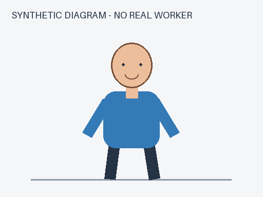
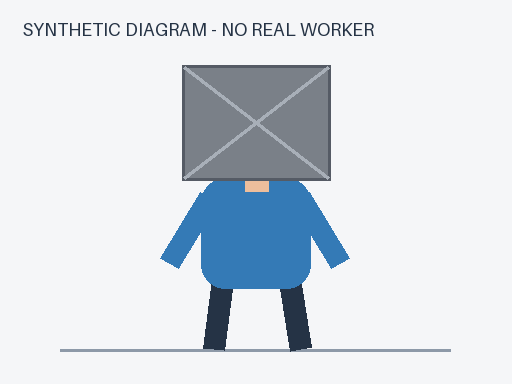

# 两张程序绘制的合成示意图

生成器`scripts/make_multimodal_fixtures.py`使用Pillow画几何人物，拒绝覆盖已有目录。图像不是照片、不是AI图像模型输出，不包含真实人员。图1可见没有头盔的头部；图2用灰色遮挡头部。标签由AI构造，非独立人类金标。

manifest固定图片SHA、结构化等价描述与gold。gold只用于本地评分，图片文件名和期望字段不传给模型。结构化基线已提供head_visible/headwear，绕过视觉解析，因此不能当成公平视觉识别竞赛。真实API结果单列，不把生成夹具本身算识别成功。
